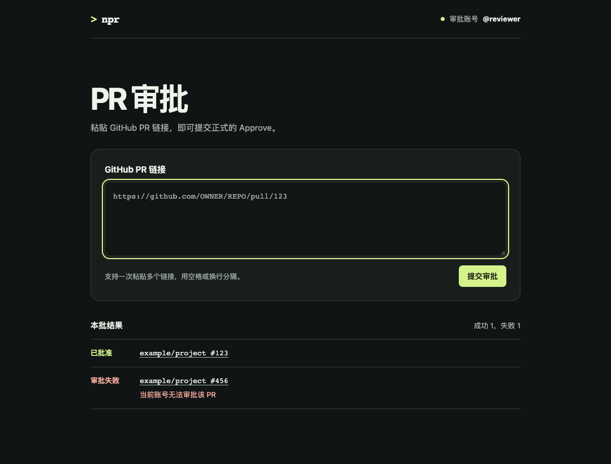

# npr

用当前 GitHub 账号批量审批 Pull Request。支持本地浏览器界面和终端命令，适用于 `github.com`。



## 安装

需要 Node.js 22+ 和 [GitHub CLI（gh）](https://cli.github.com/)。macOS 可运行 `brew install gh`。

```sh
npm install -g https://github.com/Kelier/pr-cli/releases/download/v0.2.0/npr-review-cli-0.2.0.tgz
```

## 在浏览器中审批

```sh
npr ui
```

在输入框粘贴一个或多个 PR 链接，用空格或换行分隔。**粘贴后会立即提交正式的 Approve。** 手动输入链接后也可以点「提交审批」。

页面显示当前审批账号和每条结果。点击结果中的 PR 编号可打开对应页面。可以连续处理多批，在启动界面的终端按 Ctrl+C 关闭。

如果 `gh` 已登录，`npr` 会复用当前账号。首次使用时按终端提示完成 GitHub 浏览器授权。可用 `npr` 验证身份，或用 `gh auth switch --hostname github.com` 切换账号。

## 在终端中审批

```sh
npr list https://github.com/OWNER/REPO/pull/123
npr list https://github.com/OWNER/REPO/pull/123 https://github.com/OTHER/REPO/pull/456
```

两种方式都会先校验整批链接并去重。单条审批失败时，会继续处理其余 PR。GitHub 根据仓库权限和分支保护规则决定审批是否计入必需审批数。

## 本地开发

```sh
npm ci
npm test
npm pack
npm install -g ./npr-review-cli-0.2.0.tgz
```

测试使用模拟的 GitHub CLI，无需登录或修改真实 PR。
